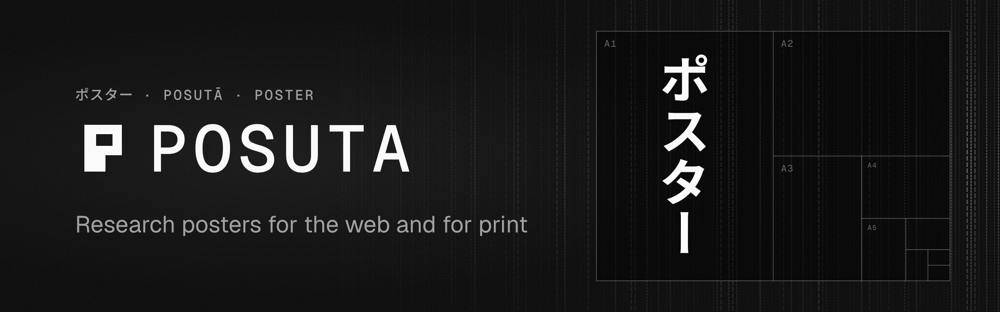

<p align="center">
  
</p>

<p align="center">
  <a href="https://www.npmjs.com/package/@posuta/posuta"></a>
  <a href="https://github.com/alvgaona/posuta/actions/workflows/ci.yaml"></a>
  <a href="LICENSE"></a>
</p>

<p align="center">
  <a href="apps/web/content/docs">Docs</a> ·
  <a href="template">Template</a> ·
  <a href="https://github.com/alvgaona/posuta/issues">Issues</a>
</p>

<p align="center">
  Write a poster in MDX. Get a static site for any free host and a vector PDF at any size.
</p>

## Quick start

```sh
pnpm create posuta my-poster
cd my-poster && pnpm install
pnpm dev                     # the poster at http://localhost:4321
pnpm exec posuta install     # once: the headless Chromium that prints the PDF
pnpm pdf                     # dist/poster.pdf and an A4 dist/handout.pdf
```

## A poster is one MDX file

```mdx
---
title: Damping, Measured
lede: One paragraph with the result, not the background.
stats:
  - { value: "3.2×", label: "faster settling than the baseline", accent: true }
print: { size: A0, orientation: portrait }
bibliography: refs.bib
---

<Section n={1} title="The result">

Plain **Markdown**, maths like $\omega_n = 4\ \mathrm{rad/s}$ and citations [@ogata2010modern].

<Chart data="step.csv" plot="step" interactive alt="Step response of two systems" />

</Section>
```

No import lines needed, since posuta's components and your own `src/components/` are available in MDX.

## What you get

- **A web page and a PDF from one source.** A static site for GitHub Pages, Cloudflare, Netlify
  or Vercel, and one vector PDF page at A0, A1, 36×48 in or your own size.
- **Nothing silently cut.** The PDF export fails if anything runs past the page, and names the block.
- **Charts that print.** Observable Plot drawn to SVG at build time, with tooltips and sliders in the browser.
- **Maths with KaTeX**, rendered at build time in text, equations and chart labels.
- **Citations.** BibTeX in, numbered citations and a reference list in any CSL style out.
- **Figures and video.** Matplotlib and other SVGs inline, and videos print their poster frame.
- **Your look.** Components are unstyled with `posuta-*` class hooks. Tailwind and plain CSS both work.
- **QR code and cite-this-poster**, linking the printed poster to its live page.

## Packages

| Package | |
| --- | --- |
| [`@posuta/posuta`](packages/posuta) | The Astro integration, components, tools (`@posuta/posuta/plot`, `/print`, `/tex`…) and the `posuta` CLI. |
| [`create-posuta`](packages/create-posuta) | `pnpm create posuta`, which copies the [starter poster](template). |

## Develop

```sh
pnpm install
pnpm dev     # the starter poster in template/
pnpm test
pnpm docs    # the documentation site in apps/web
```

## License

[MIT](LICENSE)
