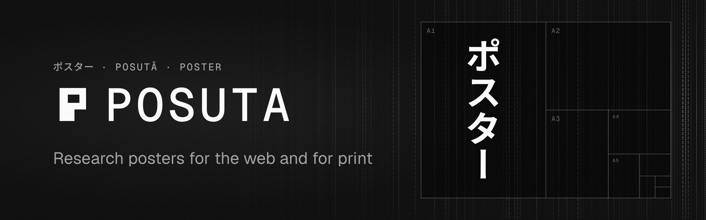

<p align="center">
  
</p>

# create-posuta

Start a [posuta](https://www.npmjs.com/package/@posuta/posuta) research poster. One MDX file
becomes a static web page and a vector PDF at any paper size.

[Docs](https://posuta.alvgaona.dev/docs) ·
[Starter poster](https://github.com/alvgaona/posuta/tree/main/template) ·
[GitHub](https://github.com/alvgaona/posuta)

## Usage

```sh
pnpm create posuta my-poster          # asks for the title and print size
pnpm create posuta my-poster --title "Damping, Measured" --print "A1 landscape"
```

Then run the poster.

```sh
cd my-poster && pnpm install
pnpm dev                     # the poster at http://localhost:4321
pnpm exec posuta install     # once, the headless Chromium that prints the PDF
pnpm pdf                     # dist/poster.pdf and an A4 dist/handout.pdf
```

`npm create posuta` and `yarn create posuta` work too.

## Options

| Flag | Value |
| --- | --- |
| `--title` | The poster's title. Asked for when left out. |
| `--print` | `A0` to `A3`, `24x36in`, `36x48in`, `42x56in` or `48x72in`, with `portrait` or `landscape`. Asked for when left out. |

## What you get

- `src/pages/index.mdx`, the poster itself, with frontmatter for the title, stats and print size.
- `src/layouts/Poster.astro` and `src/styles/theme.css`, the layout and the look, which are yours to change.
- `src/components/Section.astro`, the numbered section block.
- `charts/` and `data/` for Observable Plot charts drawn at build time.
- `.github/workflows/deploy.yaml`, which builds the page and its PDF and publishes both to GitHub Pages.

See [Quickstart](https://posuta.alvgaona.dev/docs/get-started/quickstart) and
[Project structure](https://posuta.alvgaona.dev/docs/get-started/project-structure).

## License

[MIT](https://github.com/alvgaona/posuta/blob/main/LICENSE)
