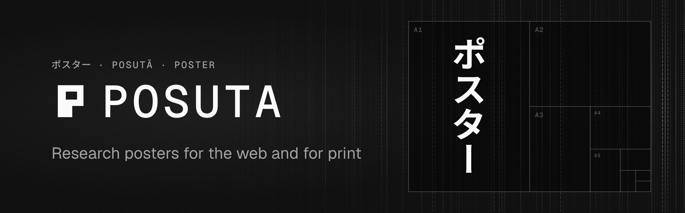

<p align="center">
  
</p>

# @posuta/posuta

Research posters for the web and for print, built with [Astro](https://astro.build). Write the
poster in one MDX file. Get a static site for any free host and a vector PDF at any paper size,
with nothing lost between the two.

[Docs](https://posuta.alvgaona.dev/docs) ·
[Starter poster](https://github.com/alvgaona/posuta/tree/main/template) ·
[GitHub](https://github.com/alvgaona/posuta)

## Start a poster

```sh
pnpm create posuta my-poster
cd my-poster && pnpm install
pnpm dev                     # the poster at http://localhost:4321
pnpm exec posuta install     # once, the headless Chromium that prints the PDF
pnpm pdf                     # dist/poster.pdf and an A4 dist/handout.pdf
```

The starter comes with a layout, a theme and a GitHub Pages workflow that publishes the page and
its PDF on every push.

## Add it to an Astro project

```sh
pnpm add @posuta/posuta
```

```js
import { defineConfig } from "astro/config";
import posuta from "@posuta/posuta";

export default defineConfig({
  site: process.env.SITE,
  integrations: [posuta()],
});
```

The integration adds MDX, KaTeX maths, BibTeX citations, and posuta's components in MDX without
import lines. A layout that wraps the page in `<Canvas>` gives it its print size and link
previews. The starter's `src/layouts/Poster.astro` is one to copy.

## A poster is one MDX file

```mdx
---
title: Damping, Measured
lede: One paragraph with the result, not the background.
stats:
  - { value: "3.2×", label: "faster settling than the baseline", accent: true }
print: { size: A0, orientation: portrait }
bibliography: refs.bib
---

<Section n={1} title="The result" sub="Measured on the bench [@ogata2010modern, §4.2].">

Plain **Markdown**, maths like $\omega_n = 4\ \mathrm{rad/s}$ and citations [@ogata2010modern].

<Chart data="step.csv" plot="step" interactive alt="Step response of two systems" />

</Section>
```

## What you get

- **A web page and a PDF from one source.** A static site for GitHub Pages, Cloudflare, Netlify
  or Vercel, and one vector PDF page at A0, A1, 36×48 in or your own size.
- **Nothing silently cut.** The PDF export fails if anything runs past the page, and names the block.
- **Charts that print.** Observable Plot drawn to SVG at build time, with tooltips and sliders in
  the browser.
- **Maths with KaTeX**, rendered at build time in text, equations, captions and chart labels.
- **Citations.** BibTeX in, numbered citations with locators and a reference list in any CSL style out.
- **Figures and video.** Matplotlib and other SVGs inline, and videos print their poster frame.
- **Your look.** Components are unstyled with `posuta-*` class hooks. Tailwind and plain CSS both work.
- **QR code and cite-this-poster**, linking the printed poster to its live page.

## Components

`Canvas`, `Row`, `Col`, `Grid`, `Cell`, `Chart`, `Figure`, `Equation`, `References` and `QR`.
Each renders without client JavaScript and prints as it looks. Those with inner structure also
come as parts, such as `Figure.Root`, `Figure.Media` and `Figure.Caption`, to arrange in your own
markup. See [Components](https://posuta.alvgaona.dev/docs/components/canvas).

## Tools

Every feature is a function first, so a layout or an island can use it directly.

| Import | What it does |
| --- | --- |
| `@posuta/posuta/plot` | Observable Plot with posuta's defaults, to SVG at build time or live in the browser |
| `@posuta/posuta/md` | Inline Markdown, maths and citations to HTML, for frontmatter text and props |
| `@posuta/posuta/tex` | `$…$` in a string to KaTeX HTML |
| `@posuta/posuta/data` | Load and thin CSV or JSON from `data/` |
| `@posuta/posuta/cite` | Format a BibTeX entry in a CSL style |
| `@posuta/posuta/bibtex` | A BibTeX entry for the poster itself |
| `@posuta/posuta/qr` | A QR code as SVG |
| `@posuta/posuta/print` | Paper sizes, and the print CSS for a size |

See [Tools](https://posuta.alvgaona.dev/docs/reference/tools).

## CLI

```sh
posuta install            # the headless Chromium that prints the PDF
posuta pdf --handout      # dist/poster.pdf, dist/handout.pdf and dist/og.png
```

`posuta pdf` serves the built site, lays the page out at its paper size, checks for overflow and
writes a tagged vector PDF with embedded fonts. See [CLI](https://posuta.alvgaona.dev/docs/reference/cli).

## License

[MIT](https://github.com/alvgaona/posuta/blob/main/LICENSE)
